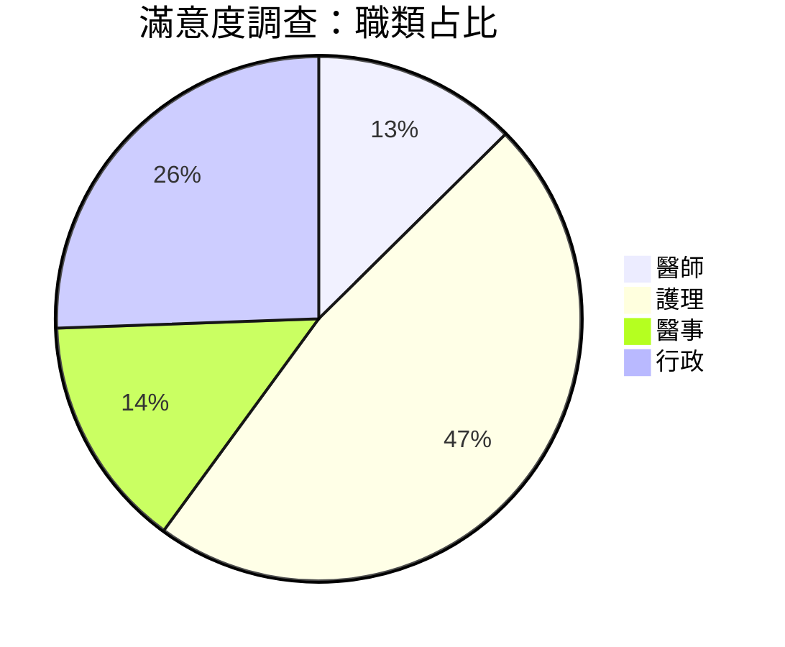
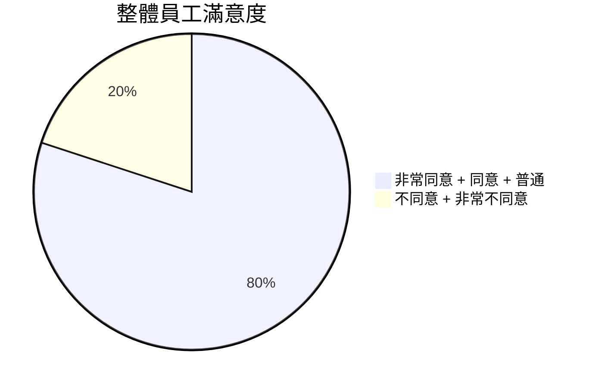
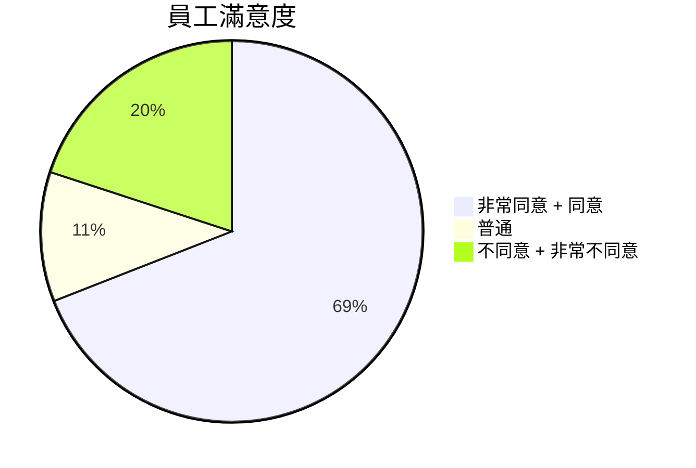
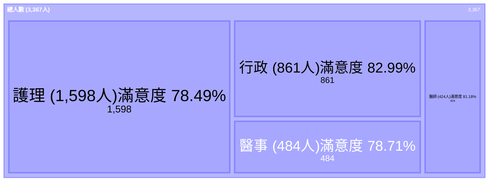

# 114年員工滿意度調查
---
## 總填答人次：3367
- 醫師 (人次)：424：13%
- 護理 (人次)：159：47%
- 醫事 (人次)：484：14%
- 行政 (人次)：861：26%

---
## 問卷可量化題目數：31
- **5種** 題目選項：**非常同意**、**同意**、**普通**、**不同意**、**非常不同意**
- **總填答人次(3,367)** x **問卷可量化題目數(31)** = **104,377** (分母)
- **滿意** (非常同意 + 同意 + 普通) = **83,513** (分子)
- **不滿意** (不同意 + 非常不同意) = **20,837** (分子)
- **整體員工滿意度** = **83,513** (分子) / **104,377** (分母) x 100% = **80.01%**

$$\text{總填答人次 } (3,367) \times \text{問卷可量化題目數 } (31) = 104,377 \text{ (分母)}$$

$$\text{滿意 } (\text{非常同意} + \text{同意} + \text{普通}) = 83,513 \text{ (分子)}$$

$$\text{整體員工滿意度} = \frac{83,513 \text{ (非常同意+同意+普通)}}{104,377 \text{ (分母)}} \times 100\% = 80.01\%$$

---
## 四大職類占比與職類滿意度：

