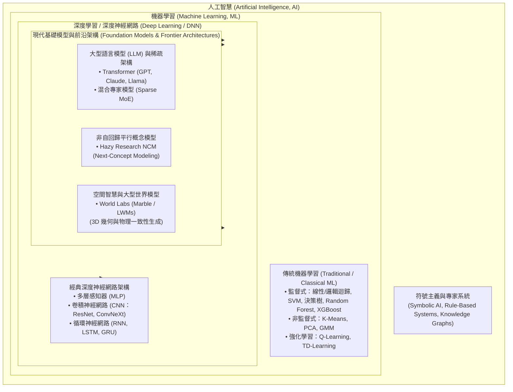
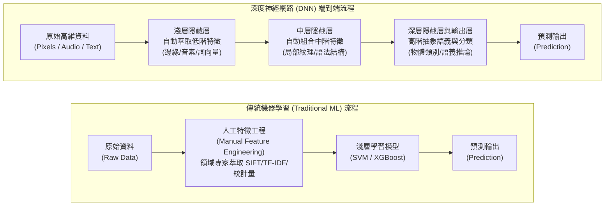
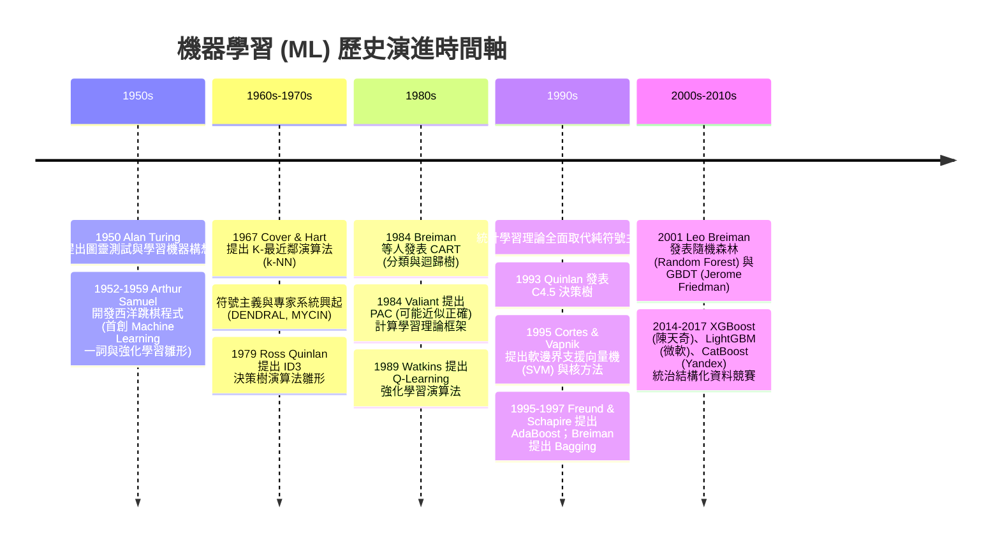
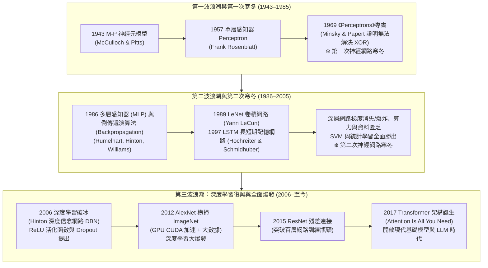
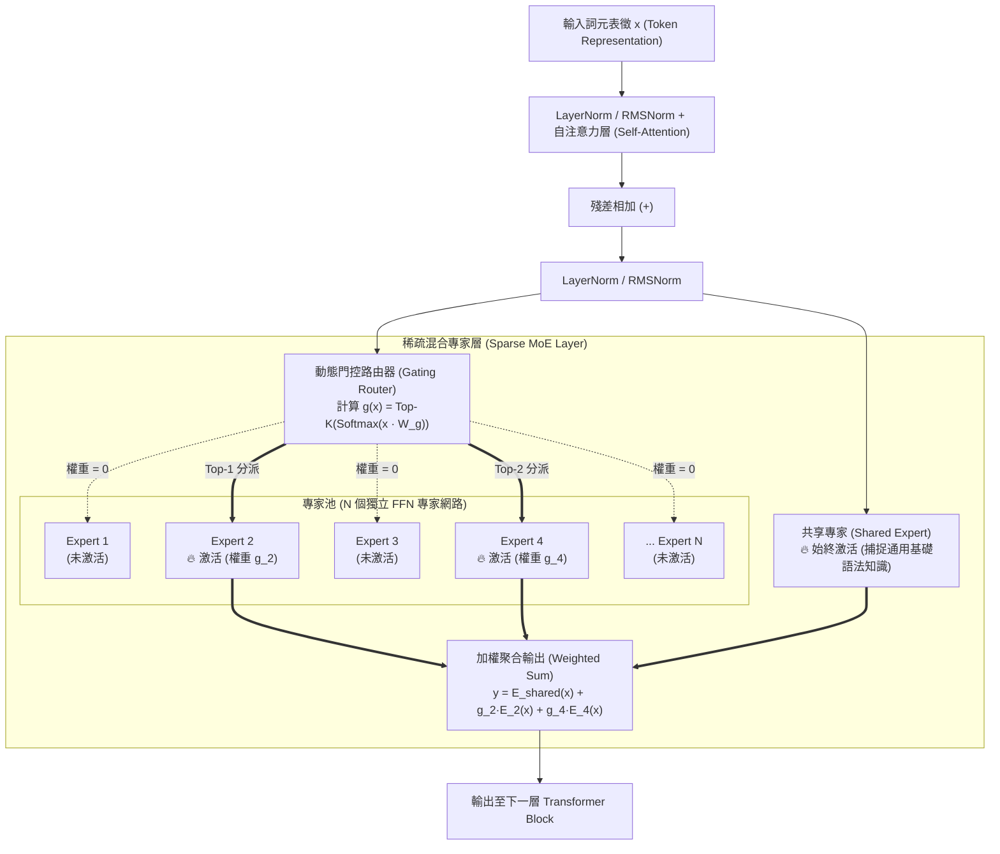
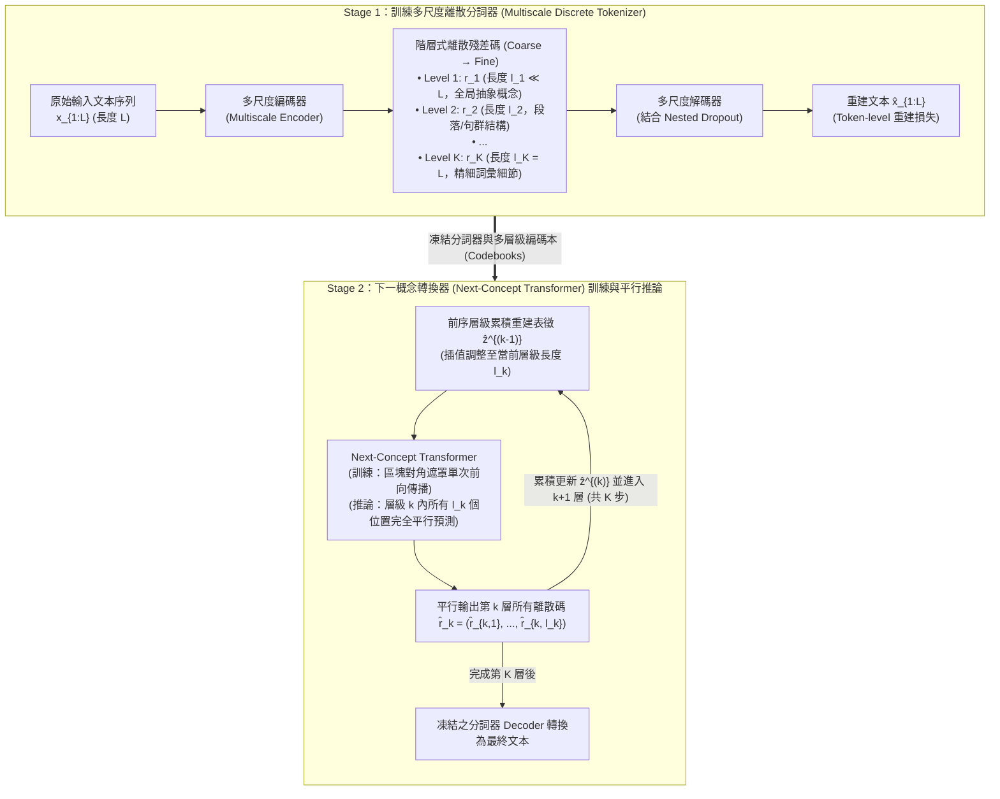
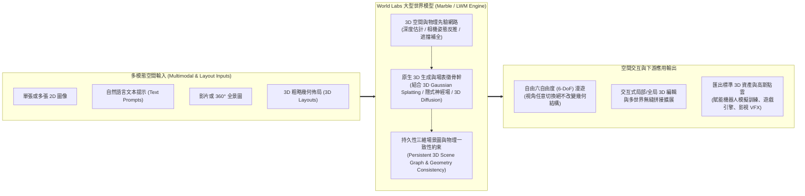
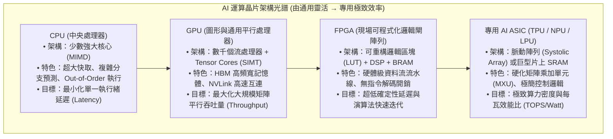
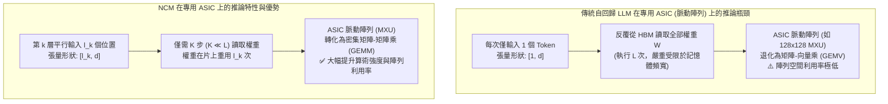

# 機器學習（ML）與深度神經網路（DNN）演進、前沿架構與硬體加速技術研究報告

---

## 1. 機器學習（ML）與深度神經網路（DNN）之定義與層級關係

在當代計算機科學與工程實踐中，**人工智慧（Artificial Intelligence, AI）**、**機器學習（Machine Learning, ML）**、**深度學習（Deep Learning, DL）**、**深度神經網路（Deep Neural Networks, DNN）** 以及 **大型語言模型（Large Language Models, LLM）** 構成了一個由廣義至狹義、層層遞進的技術同心圓體系。釐清這些概念的定義與邊界，是理解演算法演進與硬體加速架構設計的基礎。

### 1.1 核心概念定義

1. **人工智慧（Artificial Intelligence, AI）**：
   泛指由人造系統所展現出的智慧行為。其工程目標是讓電腦系統能夠執行通常需要人類智慧才能完成的任務，例如邏輯推理、知識表徵、規劃、自然語言理解、感知與物理互動。廣義的 AI 包含早期的**符號主義（Symbolic AI / 專家系統）**與現代以資料驅動為核心的**統計與連接主義（Statistical & Connectionist AI）**。
2. **機器學習（Machine Learning, ML）**：
   為實現 AI 的核心子領域。根據先驅 Arthur Samuel 於 1959 年的定義，ML 是「賦予電腦在無需進行明確程式設計（Explicit Programming）的情況下，自行學習能力的學科」。Tom Mitchell 於 1997 年則給出了嚴格的數學形式化定義：若一個電腦程式在任務 $T$（Task）上的表現（以效能指標 $P$，Performance Measure 衡量），能夠隨著經驗 $E$（Experience，即資料集）的累積而自動提升，則稱該程式從經驗 $E$ 中進行了學習。
3. **深度學習（Deep Learning, DL）與深度神經網路（Deep Neural Networks, DNN）**：
   深度學習是機器學習的一個特定分支，專注於使用具備多層非線性轉換結構的**人工神經網路（Artificial Neural Networks, ANN）**進行表徵學習（Representation Learning）。當人工神經網路的輸入層（Input Layer）與輸出層（Output Layer）之間包含**兩個或兩個以上的隱藏層（Hidden Layers）**時，該網路架構即稱為**深度神經網路（DNN）**。在實務與學術文獻中，「深度學習（DL）」側重於指稱該方法論與研究領域，而「深度神經網路（DNN）」則指稱具體的數學模型架構（包含多層感知器 MLP、卷積神經網路 CNN、循環神經網路 RNN、Transformer 等）。
4. **大型語言模型（Large Language Models, LLM）與前沿生成式架構**：
   為建構在 DNN（特別是 Transformer 及其衍生架構）之上的超大規模模型，透過在數兆（Trillions）個詞元（Tokens）上進行自監督預訓練（Self-Supervised Pre-training），湧現出通用語言理解、生成、邏輯推理與多模態空間感知能力。

### 1.2 數學集合與層級包含關係

若以集合論表達上述領域的包含關係，可表示為：

$$\text{LLM} \subset \text{DNN (DL)} \subset \text{ML} \subset \text{AI}$$

以下透過 Mermaid 圖表呈現人工智慧技術體系的層級架構與演進分支：

---

## 2. 傳統機器學習（Traditional ML）與深度神經網路（DNN）之核心差異

在業界與學術界的討論中，常將「非深度神經網路的機器學習方法」統稱為**傳統機器學習（Traditional / Classical ML）**，並將其與 **深度神經網路（DNN）** 進行對比。兩者在數學原理、特徵處理、資源需求、可解釋性及適用場景上存在本質差異。

### 2.1 核心演算法原理與底層運算機制的差異

#### （1）傳統機器學習：統計估計、核技巧與資訊理論分割
傳統機器學習演算法大多建立在嚴謹的**統計學習理論（Statistical Learning Theory）**、**凸優化（Convex Optimization）**或**資訊理論（Information Theory）**之上：
* **廣義線性模型（如 Logistic Regression、Ridge/Lasso）**：假設特徵與目標變數（或其對數勝算比 Log-odds）之間存在線性組合關係，透過最大概似估計（Maximum Likelihood Estimation, MLE）或最小平方法求解全域最佳解。
* **支援向量機（Support Vector Machine, SVM）**：基於結構風險最小化（Structural Risk Minimization）原則，尋找最大化類別邊界（Margin）的超平面。當面對非線性問題時，利用**核技巧（Kernel Trick）** $\mathcal{K}(\mathbf{x}_i, \mathbf{x}_j) = \langle \phi(\mathbf{x}_i), \phi(\mathbf{x}_j) \rangle$ 將低維度輸入映射至高維度希爾伯特空間（Hilbert Space），並轉化為凸二次規劃（Convex Quadratic Programming）問題求解：

$$\min_{\mathbf{w}, b, \boldsymbol{\xi}} \frac{1}{2} \|\mathbf{w}\|^2 + C \sum_{i=1}^{N} \xi_i \quad \text{subject to } y_i(\mathbf{w}^\top \phi(\mathbf{x}_i) + b) \ge 1 - \xi_i, \quad \xi_i \ge 0$$

* **樹模型與梯度提升樹（Decision Trees, Random Forest, XGBoost, LightGBM）**：屬於非參數化模型，透過遞迴式地對特徵空間進行軸平行切割（Axis-aligned Splitting）。每一次節點分裂皆基於資訊獲利（Information Gain）、吉尼不純度（Gini Impurity）或二階泰勒展開近似的目標函數下降量。其底層硬體運算以**條件分支判斷（`if-else` Branching）**、**陣列排序（Sorting）**、**直方圖累加（Histogram Binning）**與**隨機記憶體查找（Pointer Chasing）**為主。

#### （2）深度神經網路：階層式非線性複合映射與張量代數
DNN 放棄了全域凸優化的保證，轉而採用**階層式函數複合（Hierarchical Function Composition）**在高度非凸（Non-convex）的損失曲面上尋找局部極小值或鞍點：
* 一個具有 $L$ 層的深度神經網路，本質上是一連串仿射轉換（Affine Transformations）與逐元素非線性活化函數（Element-wise Non-linear Activations）$\sigma(\cdot)$ 的複合函數：

$$f(\mathbf{x}; \boldsymbol{\Theta}) = \sigma^{(L)}\left( \mathbf{W}^{(L)} \sigma^{(L-1)}\left( \dots \sigma^{(1)}\left( \mathbf{W}^{(1)}\mathbf{x} + \mathbf{b}^{(1)} \right) \dots \right) + \mathbf{b}^{(L)} \right)$$

* **訓練機制**：完全依賴一階梯度優化器（如 SGD, Adam, AdamW）。透過**倒傳遞演算法（Backpropagation）**與微積分連鎖律（Chain Rule），將輸出端的損失函數 $\mathcal{L}(\hat{\mathbf{y}}, \mathbf{y})$ 對每一層權重矩陣 $\mathbf{W}^{(l)}$ 求偏微分：

$$\frac{\partial \mathcal{L}}{\partial \mathbf{W}^{(l)}} = \frac{\partial \mathcal{L}}{\partial \mathbf{z}^{(L)}} \cdot \left( \prod_{k=l+1}^{L} \frac{\partial \mathbf{z}^{(k)}}{\partial \mathbf{z}^{(k-1)}} \right) \cdot \frac{\partial \mathbf{z}^{(l)}}{\partial \mathbf{W}^{(l)}}$$

* **底層運算機制**：不論是前向傳播（Forward Pass）或反向傳播（Backward Pass），DNN 超過 $90\%$ 的運算量皆高度集中於**密集矩陣乘法（General Matrix Multiply, GEMM）**、**張量卷積（Tensor Convolution）**以及**矩陣乘加運算（Multiply-Accumulate, MAC）**。這種高度規則、無資料相依分支的密集線性代數特性，使其天然契合平行運算硬體（GPU / TPU / NPU）。

---

### 2.2 特徵工程（Feature Engineering）的處理方式與人工介入程度

這是傳統 ML 與 DNN 在工作流程上最顯著的分水嶺：

* **傳統機器學習（高度依賴人工特徵工程）**：
  演算法本身無法直接從原始感測資料（如 $1024 \times 1024$ 的 RGB 像素陣列或原始音訊波形）中有效學習。資料科學家與領域專家必須耗費 $70\% \sim 80\%$ 的專案時間進行**手動特徵萃取（Hand-crafted Feature Extraction）**、特徵選擇與交互項建構（例如：影像領域的 SIFT、HOG 特徵；訊號領域的梅爾頻率倒譜係數 MFCC；文本領域的 TF-IDF 或 N-gram；金融風控領域的滑動視窗聚合統計量）。模型的上限往往取決於人類專家設計特徵的品質。
* **深度神經網路（端到端自動表徵學習，End-to-End Representation Learning）**：
  DNN 將特徵萃取與模型預測整合於同一個可微分的計算圖（Differentiable Computation Graph）中。以影像辨識為例，第一層隱藏層自動學習出類似 Gabor 濾波器的邊緣與色彩梯度偵測器；中間層將邊緣組合成局部紋理與部件（如車輪、眼睛）；最深層則形成完整的物件概念。這種**端到端（End-to-End）**學習免除了繁瑣的手工特徵設計，使人類專家從「設計特徵（Feature Engineering）」轉向「設計網路架構與損失函數（Architecture & Objective Engineering）」。

---

### 2.3 訓練資料規模與硬體運算資源要求

在資料規模（Data Scale）與模型表現的關係上，傳統 ML 與 DNN 呈現截然不同的擴展曲線（Scaling Behavior）：

* **小樣本至中等樣本區間（$N < 10^4 \sim 10^5$ 筆資料）**：
  傳統機器學習模型具有較強的**歸納偏置（Inductive Bias）**與較少的參數數量，在資料量有限時不易發生嚴重過擬合（Overfitting），且能快速收斂至優異的泛化表現。相反地，參數動輒數百萬至數千億的 DNN 在缺乏預訓練（Pre-training）的情況下，於小資料集上極易記憶雜訊而導致泛化能力崩潰。
* **大數據與超大規模區間（$N > 10^6 \sim 10^{12}$ 筆資料）**：
  傳統 ML 受限於固定的模型容量（Model Capacity）與手工特徵的資訊瓶頸，當資料量超過一定閾值後，模型精度會迅速進入**效能高原期（Performance Plateau）**。而 DNN 則遵循**擴展法則（Scaling Laws）**：只要同步擴展模型參數規模 $P$、資料量 $D$ 與訓練算力 $C$，模型的測試損失（Test Loss）會呈現冪律（Power-law）持續下降：

$$L(P, D, C) \propto \left(\frac{P_c}{P}\right)^{\alpha_P} + \left(\frac{D_c}{D}\right)^{\alpha_D} + \left(\frac{C_c}{C}\right)^{\alpha_C}$$

* **硬體資源要求**：
  傳統 ML 絕大多數可在單機多核心 CPU 與標準系統記憶體（DRAM）上於數秒至數小時內完成訓練；而現代 DNN 與 LLM 則需要由數十至數萬顆高階 GPU 或專用 ASIC（如 TPU）組成的叢集，搭配高頻寬記憶體（HBM）與高速互連網路（NVLink / InfiniBand），消耗數百萬至數億美元的電力與算力成本。

---

### 2.4 模型架構複雜度、訓練時間與結果的可解釋性（Interpretability）

1. **架構複雜度與超參數敏感度**：
   * 傳統 ML 參數規模通常在數十至數萬之間，超參數調優（如樹深 `max_depth`、學習率 `learning_rate`、正規化係數 $C$）空間相對可控。
   * DNN 參數規模橫跨百萬（$10^6$）至數兆（$10^{12}$），且涉及複雜的架構拓撲（殘差連接、注意力頭數、正規化層位置、學習率預熱與衰減排程、混合精度訓練穩定性）。
2. **訓練與推論時間**：
   * 傳統 ML 訓練極快，推論延遲常在微秒（$\mu\text{s}$）至毫秒（$\text{ms}$）等級。
   * DNN 訓練耗時數天至數月；推論階段亦需大量浮點或量化矩陣運算，需透過模型剪枝（Pruning）、知識蒸餾（Knowledge Distillation）與量化（Quantization）才能部署於低延遲環境。
3. **可解釋性（Interpretability vs. Explainability）**：
   * **傳統 ML（白盒或灰盒模型）**：線性迴歸的權重直接反映特徵的邊際效應；決策樹可完整印出從根節點到葉節點的邏輯決策路徑；集成樹模型可精確計算特徵重要度（Feature Importance）與 SHAP（SHapley Additive exPlanations）值。這在金融核貸、醫療診斷、司法評估等受嚴格法規監管（如歐盟 GDPR 與 AI Act）的領域至關重要。
   * **DNN（黑盒模型）**：知識被分散編碼（Distributed Representation）於數億個連續權重參數與高維非線性激活空間中，人類無法直接理解單一神經元或權重的物理意義。儘管可事後利用 Grad-CAM、LIME、Integrated Gradients 或機械可解釋性（Mechanistic Interpretability / Sparse Autoencoders）進行局部剖析，但仍難以提供完备的數學保證。

---

### 2.5 擅長處理的資料類型與典型應用場景

| 比較維度 | 傳統機器學習（Traditional ML） | 深度神經網路（DNN / Deep Learning） |
| :--- | :--- | :--- |
| **核心數學基礎** | 統計推論、凸優化、核方法、資訊理論與決策空間分割 | 多層非線性複合映射、非凸優化、隨機梯度下降、張量代數 |
| **特徵工程需求** | **極高**（需領域專家手動設計、篩選與轉換特徵） | **極低**（端到端自動進行階層式表徵學習） |
| **資料規模相依性** | 中小規模資料集（$10^2 \sim 10^5$）表現優異；大規模資料易飽和 | 具強烈資料飢渴性（Data-Hungry）；隨資料與算力擴展持續提升 |
| **底層硬體運算特徵** | 控制流密集（分支跳躍 `if-else`）、不規則記憶體存取、純量/向量運算 | 計算與資料流密集（GEMM 矩陣乘加、張量卷積）、高度平行化 |
| **最適硬體平台** | 多核心 CPU（高時脈、大快取、強分支預測） | GPU、專用 ASIC（TPU、NPU、LPU）、FPGA |
| **模型可解釋性** | **高**（具明確統計意義或決策規則路徑，符合法規稽核） | **低**（黑盒分散式表徵，需額外依賴 XAI 事後解釋工具） |
| **最擅長的資料類型** | **結構化／表格型資料（Tabular Data）**（具異質欄位、類別與數值混合、缺失值） | **非結構化與高維同質資料（Unstructured Data）**（影像、音訊、影片、自然語言、3D 點雲、基因序列） |
| **典型應用場景** | 信用卡詐欺偵測、信用評分、客戶流失預測、零售銷量預測、工業感測器異常檢測、量化交易因子模型 | 電腦視覺（自動駕駛、醫療影像）、語音辨識與合成、大型語言模型（LLM）、蛋白質結構預測（AlphaFold）、3D 世界生成 |

> **為什麼在結構化表格資料（Tabular Data）上，傳統梯度提升樹（XGBoost / LightGBM / CatBoost）至今仍常擊敗 DNN？**
> 根據多項實證研究（如 Grinsztajn et al., NeurIPS 2022），表格資料具有三大特性：
> 1. **特徵不具空間或序列局部相關性**（交換欄位順序不改變語義，且欄位間單位與分佈高度異質）；
> 2. **目標函數常呈現不連續的階梯狀邊界**，而 DNN 天生傾向學習過度平滑（Over-smooth）的函數；
> 3. **存在大量無關特徵（Uninformative Features）**，DNN 的旋轉不變性（Rotational Invariance）使其極易受無關特徵干擾，而決策樹的軸平行切割能直接忽略無資訊獲利的欄位。

---

## 3. 機器學習（ML）的發展歷史與關鍵里程碑

機器學習的演進史，是一部從「人類試圖將邏輯規則灌輸給機器」逐步轉向「讓機器從海量資料的統計規律中自我歸納」的科學典範轉移史。

### 3.1 1950 至 1980 年代：早期概念萌芽與符號學習階段

1. **概念萌芽與啟發式對局（1950s）**：
   * **1950 年**，艾倫·圖靈（Alan Turing）在經典論文 *Computing Machinery and Intelligence* 中不僅提出了「圖靈測試」，更前瞻性地指出：與其編寫一個模擬成人心智的龐大程式，不如編寫一個模擬兒童心智的程式，並讓其透過「獎勵與懲罰」的教育過程進行學習。
   * **1952–1959 年**，IBM 的 Arthur Samuel 開發了能夠自我對弈並記憶盤面評估分數的西洋跳棋（Checkers）程式。他於 1959 年正式提出 **Machine Learning** 一詞，並實作了最早的 $\alpha\text{-}\beta$ 剪枝與時間差分學習（Temporal-Difference Learning）概念，成功擊敗人類州級冠軍。
2. **符號學習（Symbolic Learning）與歸納邏輯（1960s–1980s）**：
   * 在此時期，AI 主流學派為**符號主義（Symbolicism）**，認為智慧的核心是符號操作與形式邏輯推論。研究者開發了專家系統（Expert Systems，如化學分析系統 DENDRAL 與醫療診斷系統 MYCIN），試圖由人類專家手動編寫數千條 `IF-THEN` 規則。
   * 然而，手動編寫規則很快遭遇了**「知識獲取瓶頸（Knowledge Acquisition Bottleneck）」**——人類專家往往無法用精確的邏輯語言描述直覺經驗，且規則庫擴大後極易產生邏輯衝突與脆弱性（Brittleness）。
   * 為解決此問題，符號機器學習學派開始研究如何從樣本中自動歸納邏輯規則與決策樹。**Ross Quinlan** 於 1979–1986 年間基於夏農資訊熵（Shannon Entropy）提出了 **ID3（Iterative Dichotomiser 3）** 演算法，後續於 1993 年演進為 **C4.5**；與此同時，統計學家 **Leo Breiman** 等人於 1984 年出版了經典著作 *Classification and Regression Trees (CART)*，引入吉尼係數（Gini Index）與代價複雜度剪枝（Cost-Complexity Pruning），奠定了現代樹模型的基石。
   * **1984 年**，Leslie Valiant 提出 **PAC 學習理論（Probably Approximately Correct Learning）**，首次從計算複雜度與機率論角度嚴格定義了「在多項式時間與有限樣本下，什麼樣的函數類別是可以被學習的」。

### 3.2 1990 至 2000 年代：統計學習理論與集成學習的黃金時代

進入 1990 年代，受惠於網際網路初期的數位化資料增長與統計物理、泛函分析的引入，機器學習徹底從「知識驅動（Knowledge-driven）」轉向**「資料驅動與統計學習（Data-driven & Statistical Learning）」**。

1. **VC 維度與支援向量機（SVM）的統治（1990s）**：
   * 蘇聯數學家 **Vladimir Vapnik** 與 Alexey Chervonenkis 建立了完整的統計學習理論，提出衡量模型容量（Capacity）的 **VC 維度（Vapnik-Chervonenkis Dimension）**，並推導出泛化誤差上界（結構風險 $=$ 經驗風險 $+$ 信心區間）。
   * **1992–1995 年**，Bernhard Boser、Isabelle Guyon、Corinna Cortes 與 Vladimir Vapnik 相繼將**核技巧（Kernel Trick）**與**軟邊界（Soft Margin）**引入最大邊界分類器，正式發表了現代 **支援向量機（SVM）**。
   * SVM 具有堅實的數學理論保證（凸二次規劃保證全域最佳解，無局部極小值困擾）、在小樣本與高維度空間（如文本分類、生物資訊基因晶片分析、早期人臉辨識）表現極為出色，因此在 1990 年代中期至 2000 年代末期徹底壓制了當時陷入停滯的神經網路。
2. **集成學習（Ensemble Learning）的崛起（1995–2010s）**：
   學者們發現，將多個預測能力僅略優於隨機猜測的「弱學習器（Weak Learners，通常為決策樹）」結合起來，可以大幅降低預測的變異數（Variance）或偏差（Bias）：
   * **Bagging（Bootstrap Aggregating）與隨機森林（Random Forest）**：Leo Breiman 於 1996 年提出 Bagging，並於 **2001 年**結合隨機特徵子空間抽樣（Random Subspace Method），發表了 **Random Forest**。透過平行訓練數百棵去相關性（De-correlated）的深層決策樹並進行多數決投票，有效防止過擬合：

$$\hat{f}_{\text{RF}}(\mathbf{x}) = \frac{1}{B} \sum_{b=1}^{B} T_b(\mathbf{x}; \Theta_b)$$

   * **Boosting 與梯度提升決策樹（GBDT）**：Yoav Freund 與 Robert Schapire 於 **1995 年**提出 **AdaBoost**，讓後續弱學習器專注於修正前序模型分錯的樣本權重。**2001 年**，史丹佛大學統計學家 **Jerome Friedman** 提出 **Gradient Boosting Machine (GBM / GBDT)**，將 Boosting 統一至函數空間的梯度下降框架中——每一棵新生成的決策樹 $h_m(\mathbf{x})$ 都在擬合當前集成模型損失函數的負梯度（殘差）：

$$F_m(\mathbf{x}) = F_{m-1}(\mathbf{x}) + \eta \cdot h_m(\mathbf{x}), \quad \text{where } h_m(\mathbf{x}) \approx -\left[ \frac{\partial \mathcal{L}(y, F(\mathbf{x}))}{\partial F(\mathbf{x})} \right]_{F=F_{m-1}}$$

   * **現代工程極致化（2014–2017 年）**：陳天奇於 2014 年發表 **XGBoost**（引入二階泰勒展開近似、顯式葉節點正規化項、稀疏感知分裂與快取感知區塊結構），隨後微軟發表 **LightGBM**（基於單邊梯度抽樣 GOSS 與互斥特徵捆綁 EFB）、Yandex 發表 **CatBoost**（解決目標編碼的預測偏移問題），將傳統統計機器學習在結構化資料上的表現推向極致。

---

## 4. 深度神經網路（DNN）的演進歷程與突破

相較於傳統機器學習的穩健發展，深度神經網路（連接主義，Connectionism）的歷史充滿了戲劇性的起落，經歷了**「三次浪潮與兩次 AI 寒冬（AI Winters）」**，最終在演算法、大數據與 GPU 算力的交匯下迎來全面爆發。

### 4.1 早期感知器（Perceptron）模型的提出與第一次發展瓶頸

1. **M-P 神經元與感知器誕生（1943–1958）**：
   * **1943 年**，神經生理學家 Warren McCulloch 與邏輯學家 Walter Pitts 發表了 **M-P 神經元模型**，將生物神經元抽象為二元閾值邏輯閘（Threshold Logic Unit）。
   * **1957–1958 年**，康乃爾航空實驗室的心理學家 **Frank Rosenblatt** 提出了具備權重學習能力的 **感知器（Perceptron）**，並建造了硬體原型機 Mark I Perceptron。單層感知器的數學模型為：

$$y = \phi\left( \sum_{i=1}^{d} w_i x_i + b \right) = \begin{cases} 1, & \text{if } \mathbf{w}^\top \mathbf{x} + b > 0 \\ 0, & \text{otherwise} \end{cases}$$

   * Rosenblatt 證明了「感知器收斂定理（Perceptron Convergence Theorem）」：若訓練資料集是線性可分的（Linearly Separable），感知器學習規則保證能在有限步數內找到分割超平面。當時媒體與學界對此抱持極度樂觀的期待。
2. **XOR 困境與第一次寒冬（1969–1980s 初）**：
   * **1969 年**，符號主義代表人物 **Marvin Minsky** 與 **Seymour Papert** 出版了著名的《Perceptrons》一書。他們以嚴謹的數學證明指出：單層感知器本質上只是一個線性分類器，連最基本的**互斥或（XOR，非線性可分）邏輯函數**都無法表徵；同時他們悲觀地推測，將感知器擴展為多層網路在當時缺乏有效的訓練演算法。
   * 這本著作直接導致美國國防高等研究計畫署（DARPA）等機構大幅削減對神經網路的研究經費，神經網路研究進入長達十餘年的**第一次寒冬**。

### 4.2 多層感知器（MLP）、倒傳遞演算法與第二次寒冬

1. **倒傳遞演算法（Backpropagation）的重現與普及（1986）**：
   * 雖然自動微分與反向傳播的數學概念在 1970 年代已由 Seppo Linnainmaa 與 Paul Werbos 分別獨立提出，但直到 **1986 年**，**David Rumelhart**、**Geoffrey Hinton** 與 **Ronald Williams** 在《Nature》期刊發表經典論文 *Learning representations by back-propagating errors*，才真正展示了如何利用可微分的 Sigmoid 活化函數 $\sigma(z) = (1 + e^{-z})^{-1}$ 取代階躍函數，並透過誤差反向傳播成功訓練**多層感知器（Multi-Layer Perceptron, MLP）**以解決 XOR 等複雜問題，且觀察到隱藏層能自動學習有意義的內部表徵。
   * **1989 年**，George Cybenko 與 Kurt Hornik 等人證明了**萬用近似定理（Universal Approximation Theorem）**：只要具備單一隱藏層且包含足夠多非線性神經元的 MLP，即可以任意精度近似緊緻集合（Compact Set）上的任何連續函數。
   * 同年（1989 年），在貝爾實驗室工作的 **Yann LeCun** 將倒傳遞演算法應用於具備局部感受野與權重共享的卷積結構，開發出用於郵政手寫數字辨識的 **LeNet**；**1997 年**，Sepp Hochreiter 與 Jürgen Schmidhuber 則提出了 **長短期記憶網路（LSTM）**，以門控機制改良循環神經網路（RNN）。
2. **深層訓練失敗與第二次寒冬（1990s 中期–2005）**：
   儘管有了理論與初步應用，當研究者試圖將神經網路加深至 3 層以上時，卻發現網路效能不升反降，主要原因有三：
   * **梯度消失與梯度爆炸（Vanishing and Exploding Gradients）**：當時普遍使用的 Sigmoid 活化函數，其導數 $\sigma'(z) = \sigma(z)(1 - \sigma(z))$ 的最大值僅為 $0.25$（當 $z=0$ 時），且在 $|z|$ 較大時趨近於 $0$。在一個 $L$ 層網路中，根據連鎖律，第一層的梯度包含 $(L-1)$ 個小於 $0.25$ 的導數連乘積，呈指數級衰減（$0.25^{L-1} \to 0$），導致靠近輸入層的權重幾乎無法更新。
   * **非凸局部極小值與過擬合**：當時缺乏大規模標註資料集，深層網路在小型資料集上極易過擬合。
   * **算力嚴重不足**：1990 年代的單核心 CPU 運算能力僅在數十至數百 MFLOPS 等級，訓練一個稍具規模的網路需耗時數週。與此同時，理論優美、無局部極小值問題的 **SVM** 與 **Random Forest** 在各類任務上全面勝出，導致頂級會議甚至排斥名為「Neural Networks」的論文，連接主義陷入**第二次寒冬**。

### 4.3 2006 年破冰與 2012 年大數據 + GPU 帶動的全面爆發

1. **2006 年深度學習（Deep Learning）破冰與關鍵演算法創新**：
   * **2006 年**，Geoffrey Hinton、Simon Osindero 與 Yee-Whye Teh 在《Neural Computation》與《Science》發表論文，提出**深度信念網路（Deep Belief Networks, DBN）**。他們利用受限玻爾茲曼機（RBM）進行「逐層非監督式預訓練（Layer-wise Unsupervised Pre-training）」，再以反向傳播進行全域微調，成功訓練了深層網路，並正式啟用 **「Deep Learning（深度學習）」** 這一新名稱以擺脫過往神經網路的負面印象。
   * 隨後數年間，學界發現其實無需繁瑣的 RBM 預訓練，只要結合以下幾項關鍵工程與演算法突破，即可直接從頭訓練深層網路：
     1. **ReLU（Rectified Linear Unit）活化函數**（Nair & Hinton, 2010; Glorot et al., 2011）：定義為 $\text{ReLU}(z) = \max(0, z)$。在正區間其導數恆為 $1$，徹底消除了連乘導致的梯度指數衰減問題，且計算僅需簡單比較，大幅加速收斂。
     2. **權重初始化策略（Xavier / He Initialization）**：確保前向訊號與反向梯度的變異數在跨層傳遞時保持穩定。
     3. **Dropout 正規化**（Srivastava et al., 2014）：訓練時隨機將一定比例的神經元輸出置零，防止特徵協同適應（Co-adaptation），等效於對指數個子網路進行集成。
     4. **批次正規化（Batch Normalization, BN）**（Ioffe & Szegedy, 2015）：在每一層動態標準化小批次（Mini-batch）激活值的均值與變異數，平滑損失曲面並允許使用更大的學習率。
2. **2012 年「AlexNet 時刻」：演算法、大數據與 GPU 的完美交匯**：
   * **大數據基石**：李飛飛（Fei-Fei Li）團隊於 2009 年建構了包含超過 1,400 萬張標註影像、涵蓋 22,000 個類別的 **ImageNet** 資料集，並自 2010 年起舉辦 ILSVRC 視覺辨識挑戰賽。在 2010 與 2011 年，採用傳統 SIFT + Fisher Vector + SVM 的方法Top-5 錯誤率徘徊於 $25.8\% \sim 28.2\%$。
   * **2012 年突破**：Geoffrey Hinton 與其學生 Alex Krizhevsky、Ilya Sutskever 提出了 **AlexNet**——一個包含 8 層（5 個卷積層、3 個全連接層，共 6,000 萬個參數）的深度 CNN。他們結合了 ReLU 與 Dropout，並利用 **兩張 NVIDIA GTX 580 GPU（透過 CUDA 編寫跨卡平行卷積核心）** 進行了為期 5 至 6 天的訓練。AlexNet 一舉將 ImageNet Top-5 錯誤率大幅降至 **$15.3\%$**（領先第二名傳統方法超過 10.8 個百分點），震驚全球科技界，正式引爆當代深度學習革命。

### 4.4 現代延伸架構（CNN、RNN、Transformer）的演進與影響

1. **卷積神經網路（CNN）與空間階層感知**：
   * 核心原理：利用**局部感受野（Local Receptive Fields）**、**權重共享（Weight Sharing）**與**空間池化（Spatial Pooling）**，賦予模型對影像平移的不變性（Translation Invariance）與極佳的參數效率。
   * 演進脈絡：從 AlexNet（2012）$\to$ VGGNet（2014，使用 $3 \times 3$ 小卷積核堆疊至 19 層）$\to$ GoogLeNet/Inception（2014，多尺度平行卷積）$\to$ **ResNet（何愷明等，2015）**。ResNet 提出劃時代的**殘差連接（Residual / Skip Connection）**，讓網路學習殘差映射 $\mathcal{F}(\mathbf{x}) = \mathcal{H}(\mathbf{x}) - \mathbf{x}$，輸出為 $\mathbf{y} = \mathcal{F}(\mathbf{x}, \{W_i\}) + \mathbf{x}$。由於恆等映射（Identity Mapping）提供了無損的梯度高速公路（$\frac{\partial \mathbf{y}}{\partial \mathbf{x}} = \frac{\partial \mathcal{F}}{\partial \mathbf{x}} + \mathbf{I}$），成功將網路深度推進至 152 層甚至上千層，且此殘差結構也成為後續 Transformer 不可或缺的標準組件。
2. **循環神經網路（RNN / LSTM / GRU）與序列建模瓶頸**：
   * 核心原理：針對自然語言、語音、時間序列等具先後順序的資料，透過隱藏狀態 $\mathbf{h}_t = \tanh(\mathbf{W}_{hh}\mathbf{h}_{t-1} + \mathbf{W}_{xh}\mathbf{x}_t + \mathbf{b})$ 在時間步（Time steps）間傳遞記憶。LSTM 與 GRU（Cho et al., 2014）則引入遺忘門、輸入門與輸出門來維持長距離記憶。
   * **致命瓶頸**：
     1. **序列時間相依性無法平行化**：第 $t$ 步的計算必須等待第 $t-1$ 步完成（$\mathbf{h}_{t-1} \to \mathbf{h}_t$），導致訓練時無法在序列長度維度上利用 GPU 進行平行運算，無法擴展至海量語料。
     2. **固定維度資訊壓縮瓶頸**：即便有 LSTM 門控與早期 Seq2Seq 注意力機制（Bahdanau et al., 2014），當序列長度超過數百個詞元時，遠距離歷史資訊仍會嚴重流失。
3. **Transformer 架構（2017）：徹底拋棄循環與卷積的平行化革命**：
   * **2017 年**，Google 研究團隊（Ashish Vaswani 等 8 位作者）發表了里程碑論文 ***Attention Is All You Need***，提出 **Transformer** 架構。
   * Transformer 徹底捨棄了 RNN 的循環結構，改以**縮放點積自注意力機制（Scaled Dot-Product Self-Attention）**與**位置編碼（Positional Encoding）**處理序列。對於輸入序列表徵 $\mathbf{X} \in \mathbb{R}^{N \times d}$，透過三個線性投影矩陣產生查詢（Query, $\mathbf{Q}$）、鍵（Key, $\mathbf{K}$）與值（Value, $\mathbf{V}$）：

$$\text{Attention}(\mathbf{Q}, \mathbf{K}, \mathbf{V}) = \text{softmax}\left( \frac{\mathbf{Q}\mathbf{K}^\top}{\sqrt{d_k}} \right)\mathbf{V}$$

   * **三大革命性優勢**：
     1. **任意兩位置間的最短路徑為 $\mathcal{O}(1)$**：無論兩個詞元在文本中相距多遠，自注意力機制都能在單層內直接計算兩者的語義關聯權重，徹底解決長距離依賴問題。
     2. **訓練階段完全平行化**：整個序列的所有詞元可在單次矩陣乘法中同時計算，完美釋放 GPU 與 TPU 的平行算力。
     3. **多頭注意力（Multi-Head Attention, MHA）**：允許模型在不同的表示子空間中同時關注語法、指代、語義等多重關係。

---

## 5. 大型語言模型（LLM）發展歷程與混合專家模型（MoE）架構

### 5.1 從 Transformer 到大型語言模型（LLM）的演進脈絡

自 2017 年 Transformer 問世後，基礎模型（Foundation Models）在短短數年間經歷了路線分化、規模收斂與範式演進：

#### （1）三大架構路線的分化與收斂（2018–2020）
1. **Encoder-Only（雙向編碼器路線，以 BERT 為代表）**：
   Google 於 2018 年提出 **BERT**，採用遮蔽語言模型（Masked Language Model, MLM）進行雙向語境預訓練，在自然語言理解（NLU，如分類、命名實體識別、情感分析）任務上取得統治地位，但不擅長開放式文本生成。
2. **Encoder-Decoder（序列到序列路線，以 T5、BART 為代表）**：
   保留原始 Transformer 的編碼器與解碼器，將所有 NLP 任務統一為 Text-to-Text 格式。
3. **Decoder-Only（自回歸因果解碼器路線，以 GPT 系列為代表 — 最終主流）**：
   OpenAI 自 **GPT-1（2018）**、**GPT-2（2019，15 億參數）** 到 **GPT-3（2020，1,750 億參數）** 堅定採用因果遮罩自注意力（Causal Masked Self-Attention），訓練目標極其單純——根據前文序列 $x_1, x_2, \dots, x_{t-1}$ 進行**下一個詞元預測（Next-Token Prediction）**，最大化對數概似函數：

$$\mathcal{L}_{\text{AR}}(\boldsymbol{\theta}) = -\sum_{t=1}^{T} \log P(x_t \mid x_1, x_2, \dots, x_{t-1}; \boldsymbol{\theta})$$

   GPT-3 證明了當參數與訓練語料達到臨界規模時，模型無需更新梯度權重，僅憑提示詞中的少樣本示範即可展現強大的**上下文學習（In-Context Learning, ICL）**與**湧現能力（Emergent Abilities）**。此後，Google（PaLM, Gemini）、Meta（Llama 系列）、Anthropic（Claude 系列）與 DeepSeek 皆全面收斂至 Decoder-Only 路線。

#### （2）現代 LLM 訓練與推論三階段範式（2022–至今）
當代前沿 LLM 的構建已標準化為三個核心階段：
1. **大規模自監督預訓練（Pre-training）**：
   遵循 **Chinchilla Scaling Laws（Hoffmann et al., 2022）**（指出模型參數量與訓練 Token 數應等比例擴展，且考量推論成本時應傾向於在更多 Token 上進行「過度訓練 Over-training」），在數兆至數十兆個高品質清洗語料、程式碼與數學文本上進行下一個詞元預測，賦予模型世界知識與基礎表徵。此階段同時引入 **RoPE（旋轉位置編碼）**、**GQA（分組查詢注意力，Grouped-Query Attention）**或 **MLA（多頭潛在注意力，Multi-head Latent Attention，大幅壓縮 KV Cache）**以及 **SwiGLU** 活化函數。
2. **後訓練與人類意圖對齊（Post-training & Alignment）**：
   * **監督式微調（Supervised Fine-Tuning, SFT）**：使用高質量的指令-回答對（Instruction-following Data）啟動模型的對話與遵循指令能力。
   * **基於人類回饋的強化學習（RLHF）與偏好優化**：早期採用訓練獎勵模型（Reward Model）結合 **PPO（Proximal Policy Optimization）** 演算法（如 InstructGPT / ChatGPT, 2022）；隨後發展出無需獨立獎勵模型的 **DPO（Direct Preference Optimization, 2023）**，以及針對數學與程式碼等具可驗證獎勵（Verifiable Rewards）任務的 **GRPO（Group Relative Policy Optimization，如 DeepSeek-R1 採用）**，透過群組內相對優勢估計省去龐大的 Critic 價值網路。
3. **推論期運算擴展與慢思考推理模型（Test-Time Compute Scaling / Reasoning Models）**：
   以 OpenAI o1/o3、DeepSeek-R1、Gemini Thinking 等模型為代表，將算力投入從「單純擴大預訓練參數」延伸至「推論階段的長思維鏈（Long Chain-of-Thought, CoT）搜尋、自我反思與驗證」，讓模型在輸出最終答案前生成數千個內部推理 Token，突破複雜數理與邏輯推理瓶頸。

---

### 5.2 混合專家模型（Mixture of Experts, MoE）核心原理與優勢

隨著密集型模型（Dense Models）參數逼近數千億至上兆規模，每次生成一個 Token 都必須激活全部參數，導致訓練與推論的浮點運算量（FLOPs）與能源消耗難以為繼。**稀疏混合專家模型（Sparse Mixture of Experts, MoE）** 成為突破「模型容量（參數總量）」與「單次運算成本（FLOPs）」強綁定關係的核心架構。

#### （1）MoE 核心原理與動態路由機制
MoE 的概念最早可追溯至 1991 年 Robert Jacobs 與 Geoffrey Hinton 等人的研究，後由 Noam Shazeer 等人（2017）引入深度學習，並在 **Switch Transformer（2021）**、**Mixtral 8x7B（2023）**、**DeepSeek-V2/V3（2024–2025）** 與現代前沿多模態模型中成為標準架構。

在標準 Transformer 區塊中，自注意力層之後連接著一個占據模型約 $\frac{2}{3}$ 參數量的密集前饋網路（Feed-Forward Network, FFN）。MoE 架構將這個單一的大型 FFN 替換為 **$N$ 個獨立的「專家子網路（Expert Sub-networks）」** $\{E_1(\mathbf{x}), E_2(\mathbf{x}), \dots, E_N(\mathbf{x})\}$，並配置一個輕量級的**門控路由網路（Gating Network / Router）** $G(\mathbf{x})$。

對於每個輸入 Token 的隱藏狀態向量 $\mathbf{x} \in \mathbb{R}^d$，路由器透過線性矩陣 $\mathbf{W}_g \in \mathbb{R}^{d \times N}$ 計算各專家的得分，並僅選取分數最高的 **前 $K$ 個專家（Top-$K$ Routing，通常 $K \ll N$，例如 $N=64, K=2$ 或細粒度專家 $N=256, K=8$）** 進行計算：

$$G(\mathbf{x}) = \text{Softmax}\left( \text{TopK}(\mathbf{x} \cdot \mathbf{W}_g, K) \right), \quad \text{where } \text{TopK}(\mathbf{v}, K)_i = \begin{cases} v_i, & \text{if } v_i \text{ is in top } K \text{ of } \mathbf{v} \\ -\infty, & \text{otherwise} \end{cases}$$

該 MoE 層的最終輸出 $\mathbf{y}$ 為被激活專家的加權總和（在現代架構如 DeepSeekMoE 中，還會額外包含 $N_s$ 個始終激活的「共享專家 Shared Experts」以剝離通用知識，讓路由專家高度專業化）：

$$\mathbf{y} = \sum_{j=1}^{N_s} E_j^{\text{shared}}(\mathbf{x}) + \sum_{i \in \text{TopK}} G(\mathbf{x})_i \cdot E_i^{\text{routed}}(\mathbf{x})$$

#### （2）負載平衡機制（Load Balancing）與專家崩潰問題
在訓練 MoE 時，若不加干預，路由器極易陷入「贏者通吃」的正回饋循環——少數幾個早期表現較好的專家被反覆選中並獲得更多梯度更新，而其餘絕大多數專家永遠不被激活，稱為**路由崩潰（Routing Collapse）**。同時，若大量 Token 湧向同一個專家所在的 GPU（Expert Parallelism），會造成嚴重的硬體等待瓶頸。

為解決此問題，傳統 MoE 引入**輔助負載平衡損失（Auxiliary Load Balancing Loss）**：設批次內共有 $T$ 個 Token，$f_i$ 為被分配給第 $i$ 個專家的 Token 比例，$P_i$ 為路由器分配給第 $i$ 個專家的平均機率，則負載平衡損失定義為：

$$\mathcal{L}_{\text{aux}} = \alpha \cdot N \sum_{i=1}^{N} f_i \cdot P_i, \quad \text{where } f_i = \frac{1}{T} \sum_{\mathbf{x} \in \mathcal{B}} \mathbb{I}(\text{Token } \mathbf{x} \text{ selects Expert } i), \quad P_i = \frac{1}{T} \sum_{\mathbf{x} \in \mathcal{B}} \text{Softmax}(\mathbf{x}\mathbf{W}_g)_i$$

當所有專家平均分配 Token 時（$f_i = P_i = \frac{1}{N}$），$\mathcal{L}_{\text{aux}}$ 達到最小值；近年最新演進（如 DeepSeek-V3）更提出了**無輔助損失負載平衡（Auxiliary-Loss-Free Load Balancing）**，透過為每個專家動態維護一個不影響模型梯度的偏置項 $b_i$ 來調節路由選擇，避免了輔助損失干擾語言模型的主訓練目標。

#### （3）MoE 在參數擴展與運算效率上的核心優勢與硬體挑戰
* **優勢 1：解耦參數容量與計算成本（Sub-linear Compute Scaling）**：例如一個總參數高達 6,710 億（671B）的 MoE 模型，每個 Token 僅激活 370 億（37B）參數。這意味著模型擁有近 7,000 億參數的龐大知識儲存容量，但其單次前向傳播的計算量（FLOPs）僅相當於一個 37B 的密集模型。
* **優勢 2：訓練吞吐量與收斂速度大幅提升**：在相同的訓練算力預算（FLOPs）下，MoE 模型的訓練收斂速度通常是同等計算量 Dense 模型的 $3\times \sim 5\times$。
* **硬體挑戰（記憶體容量與 All-to-All 通訊瓶頸）**：雖然每個 Token 僅激活少數專家，但**所有專家的權重都必須常駐於高頻寬記憶體（HBM/VRAM）中**，對記憶體容量要求極高；此外，在跨多卡部署專家平行（Expert Parallelism）時，需頻繁執行跨節點的 `All-to-All` 張量分發與聚合通訊，對晶片互連頻寬（如 NVLink 與 RDMA 網路）構成極大考驗。

---

## 6. 新興前沿模型架構：Hazy Research NCM 與 World Labs 空間智慧模型

儘管自回歸（Autoregressive, AR）Transformer 與 LLM 取得了空前成功，但當代 AI 研究正積極突破兩大根本限制：**（1）自回歸逐詞生成帶來的推論延遲與全局規劃缺陷**，以及 **（2）純文本/2D 平面模型缺乏對真實三維物理世界的空間理解**。本節深入剖析代表這兩大突破方向的最新前沿架構：**Hazy Research 的 NCM 模型**與 **World Labs 的空間智慧模型**。

### 6.1 Hazy Research 提出的 NCM（Next-Concept Modeling）模型解析

**NCM（Next-Concept Modeling，下一概念建模）** 是由史丹佛大學（Stanford University）**Christopher Ré 教授**領軍的 **Hazy Research** 實驗室與 Together AI 研究團隊（Hermann Kumbong、Ishan S. Khare、Simran Arora、Azalia Mirhoseini 等）共同提出的全新**非自回歸（Non-Autoregressive）、由粗到細（Coarse-to-Fine）平行文本生成架構**（開源專案：`https://github.com/HazyResearch/ncm`）。

#### （1）背景動機：打破自回歸（AR）與擴散語言模型（DLM）的推論困境
1. **傳統自回歸模型（AR LLMs）的瓶頸**：AR 模型必須嚴格按照從左到右的順序，一次生成一個 Token（$x_1 \to x_2 \to \dots \to x_L$）。生成長度為 $L$ 的序列需要執行 $L$ 次完整的前向傳播（Sequential Forward Passes），無法在輸出時間步上平行化，且缺乏先確立全局結構再填入細節的「全局規劃（Global Planning）」能力。
2. **擴散語言模型（Diffusion Language Models, DLMs）的瓶頸**：為實現平行生成，學界近年發展出離散擴散語言模型（如 MDLM、SEDD、DUO），從全遮蔽序列開始平行去噪。然而，DLMs 仍需耗費數十至數百個去噪步數（高函數評估次數，Number of Function Evaluations, NFE），且**每一步都必須在完整序列長度 $L$ 上進行全序列計算**，同時訓練階段需要比 AR 模型多出數倍的訓練 Token 才能收斂。

**NCM 的核心洞察**：人類撰寫文章或解題時，並非從第一個字盲目寫到最後一個字，也不是對整篇文章同時從亂碼去噪；而是**先構思高階大綱與核心概念（Coarse Concepts），再逐步擴充句型結構與詞彙細節（Fine Details）**。

#### （2）NCM 的兩階段核心架構設計（Two-Stage Architecture）

NCM 將文本生成解耦為「多尺度離散概念表徵學習」與「由粗到細層級平行生成」兩個階段：

1. **Stage 1：多尺度離散分詞器（Multiscale Discrete Tokenizer）**：
   * NCM 受視覺自回歸模型（Visual Autoregressive Modeling, VAR）啟發，但針對離散且具高度語法敏感性的文本進行了關鍵重構。
   * 給定長度為 $L$ 的輸入文本序列 $\mathbf{x}_{1:L}$，編碼器將其壓縮並量化為 $K$ 個由粗到細的離散殘差碼層級（Multiscale Residual Codes）$\{\mathbf{r}_1, \mathbf{r}_2, \dots, \mathbf{r}_K\}$，其中各層級的序列長度滿足嚴格遞增關係：

$$\ell_1 < \ell_2 < \dots < \ell_K = L$$

   * 早期的粗粒度層級（如 $\mathbf{r}_1, \mathbf{r}_2$）序列極短（$\ell_k \ll L$），僅用少數幾個離散碼捕捉整段文本的核心概念與語義骨架；後續層級則逐步拉長序列並透過殘差量化（Residual Quantization）補齊局部語法與用字細節。
   * **針對文本的三大設計創新**：
     1. **獨立層級編碼本（Per-level Codebooks）**：不同尺度的概念抽象程度不同，因此每個層級 $k$ 配備獨立的向量量化編碼本 $\mathcal{C}_k$。
     2. **巢狀丟棄（Nested Dropout）**：在訓練分詞器時，隨機在某個層級 $k < K$ 截斷後續殘差碼，強制僅用前 $k$ 層重建文本。這確保了早期粗層級必須承載最具資訊量的高階語義概念，而不會退化為依賴最後一層才編碼資訊。
     3. **Token 級別重建目標（Token-level Reconstruction Objective）**：直接最大化原始文本 Token 的交叉熵重建機率。

2. **Stage 2：下一概念轉換器（Next-Concept Transformer）**：
   * 凍結第一階段訓練好的多尺度分詞器後，第二階段訓練一個 Transformer 生成器，學習**「從前 $k-1$ 層的累積粗概念表徵 $\hat{\mathbf{z}}^{(k-1)}$，一次性平行預測第 $k$ 層的所有離散碼 $\mathbf{r}_k$」**。其機率分解模型為：

$$P(\mathbf{r}_1, \mathbf{r}_2, \dots, \mathbf{r}_K) = \prod_{k=1}^{K} P\left(\mathbf{r}_k \mid \mathbf{r}_1, \dots, \mathbf{r}_{k-1}\right) = \prod_{k=1}^{K} \prod_{i=1}^{\ell_k} P\left(r_{k, i} \mid \hat{\mathbf{z}}^{(k-1)}\right)$$

   * **高效訓練機制**：在訓練時，將所有層級 $1 \dots K$ 串接起來，透過**區塊對角注意力遮罩（Block-diagonal Attention Mask）**——允許第 $k$ 層的所有位置雙向關注前序累積表徵，但遮蔽同層真實標籤——在**單次前向傳播（Single Forward Pass）**中同時計算所有層級的交叉熵損失。此外，訓練時會隨機擾動（Corrupt）部分條件輸入碼，大幅提升模型在推論時對早期層級預測誤差的自我修正能力。
   * **極速平行推論機制**：在推論生成時，模型僅需執行 **$K$ 步（例如 $K \approx 8 \sim 11$ 步，遠小於序列長度 $L$）**。在第 $k$ 步中，第 $k$ 層內的所有 $\ell_k$ 個離散概念碼是**完全平行生成**的；且因為早期步驟的序列長度 $\ell_k$ 極短，前幾步的注意力計算複雜度 $\mathcal{O}(\ell_k^2)$ 幾乎可以忽略不計！

#### （3）NCM 的實測效能與技術突破
* **推論速度提升 $10\times \sim 31\times$**：在單張 NVIDIA H100 GPU 實測中，NCM 在無條件文本生成（LM1B、OpenWebText）上比最強的擴散語言模型快 $10\times \sim 21\times$，函數評估次數（NFE）減少 $11\times$；在條件生成任務（WMT14 德英機器翻譯、XSum 摘要）上，達到同等或更佳的 BLEU / ROUGE-L 分數，同時**生成速度高達 $31\times$**。
* **訓練樣本效率提升 $4\times \sim 5\times$**：即使把訓練分詞器與生成器的 Token 預算相加，NCM 所需的訓練 Token 數仍比擴散語言模型少 $4\times \sim 4.9\times$。
* **全局規劃與邏輯推理優勢**：在需要嚴格滿足全局約束的高難度數獨（Hard Sudoku）推理基準上，傳統自回歸（AR）模型因無法回頭修改早期決策，解題率僅 $1.0\%$；擴散基線（MDLM / DUO / FMLM+）解題率為 $30.2\% \sim 81.3\%$；而 NCM 憑藉「先確立全局結構、再逐步細化」的機制，以最少的計算步數達到 **$86.1\%$** 的最高解題率。

---

### 6.2 World Labs 與空間智慧（Spatial Intelligence / Large World Models）

如果說 LLM 與 NCM 解決的是符號與語言維度的概念生成，那麼由史丹佛大學教授、ImageNet 締造者 **李飛飛（Fei-Fei Li）** 博士與 Justin Johnson、Christoph Lassner、Ben Mildenhall（NeRF 原作者之一）共同創立的 **World Labs**，則致力於開創 AI 的下一個核心前沿：**空間智慧（Spatial Intelligence）**與**大型世界模型（Large World Models, LWMs）**。

#### （1）什麼是空間智慧（Spatial Intelligence）？為何 LLM 與 2D 影片模型不夠？
* **LLM 的「缸中之腦」困境**：當代大型語言模型讀遍了人類所有文字，能夠用文字描述「水杯從桌子邊緣掉落會碎裂」，但由於缺乏三維空間座標、深度、遮擋、重力與剛體碰撞的原生表徵，它在三維幾何推理、物理互動規劃與具身控制（Embodied Control）上極易產生脫離物理現實的幻覺。
* **2D 影片生成模型（如 Sora、Runway）的「幾何遺忘」問題**：主流影片擴散模型本質上是在二維像素時間序列 $(H \times W \times T)$ 上擬合光流與外觀分佈。當虛擬攝影機視角向右旋轉 $180^\circ$ 再轉回原處時，原本房間裡的桌子往往會消失或變形——因為模型內部沒有維護一個**持久且空間一致的三維世界狀態（Persistent & Spatially Consistent 3D State）**。
* **空間智慧的定義**：讓 AI 具備感知（Perceive）、生成（Generate）、推理（Reason）並與三維虛擬及物理世界進行交互（Interact）的能力，將「看見像素（Seeing Pixels）」轉化為「理解三維幾何結構與物理行動（Doing & Reasoning in 3D Worlds）」。

#### （2）World Labs 核心產品與模型架構：Marble 與大型世界模型（LWM）

World Labs 推出的旗艦世界生成系統 **Marble** 展現了大型世界模型（LWM）的核心技術突破：
1. **從像素直接升維至持久 3D 世界（From Pixels to Persistent 3D Worlds）**：
   不同於先生成 2D 影片再嘗試後處理重建，Marble 在底層直接建構三維幾何與輻射場表徵（深度結合 **3D Gaussian Splatting (3DGS)**、神經輻射場 **NeRF** 衍生技術與原生 3D 生成式 Transformer/Diffusion 架構）。使用者僅需輸入單張照片、一段文字描述或粗略的 3D 空間佈局（3D Layout），模型即可推理出被遮擋的背面結構、一致的光影反射與精確的物理尺度，生成可自由穿梭（6-DoF 漫遊）的高擬真 3D 環境。
2. **嚴格的空間與時間持久性（Spatial Persistence & Consistency）**：
   一旦世界被生成，其三維幾何結構即被固化於持久狀態空間中。無論使用者在場景中如何移動視角、離開房間再返回，所有物體的相對位置、透視關係與物理比例均保持 $100\%$ 一致。
3. **可控 3D 佈局與無限世界拼接（Interactive Editing & World Expansion）**：
   支援創作者以 3D 邊界框或語義指令精確控制空間佈局，對單一物件或全局風格進行即時交互編輯，並能將多個獨立生成的 3D 區域無縫擴展、拼接成龐大的開放世界。
4. **具身智慧與機器人模擬訓練（Robotics & Simulation）**：
   與訓練 LLM 擁有整個網際網路的現成文本不同，訓練實體機器人（Embodied AI）極度缺乏真實世界的三維物理交互數據。World Labs 透過結合收購之高性能物理模擬技術（如 SceniX）並於 2026 年與硬體大廠 AMD 展開深度算力與架構合作，利用大型世界模型合成無限多樣、符合真實物理與幾何規律的可交互虛擬環境，直接解決機器人策略學習（Policy Learning）的模擬到真實遷移（Sim-to-Real Gap）痛點。

---

## 7. 硬體加速技術演進與模型適配性深度分析

AI 演算法的每一次躍遷，本質上都受到底層硬體算力架構的制約與推動（即 Richard Sutton 所提出的 **「苦澀的教訓 The Bitter Lesson」**：長期來看，最能有效利用摩爾定律與平行算力的通用方法終將勝出）。

### 7.1 CPU、GPU 與專用 ASIC（TPU、NPU、LPU）之架構差異與應用場景

不同計算晶片在設計哲學上面臨著 **「通用靈活性（Flexibility）」** 與 **「領域特定效率（Efficiency / Throughput per Watt）」** 的根本取捨：

#### （1）CPU（Central Processing Unit，中央處理器）
* **微架構特點**：採用馮·紐曼架構與 **MIMD（多指令流多資料流）** 設計。晶片面積絕大多數分配給**複雜的控制單元（Control Unit，包含分支預測器、亂序執行 Out-of-Order 引擎）**與**多層級大容量快取記憶體（L1/L2/L3 Cache）**，實際執行算術邏輯運算的 ALU 數量較少（通常 8 至 192 核心）。
* **AI 角色**：極度擅長處理具有複雜條件跳躍（`if-else`）、指標追蹤（Pointer Chasing）與不規則記憶體存取的任務。因此，CPU 是**傳統機器學習（決策樹、Random Forest、XGBoost 小批量推論、特徵工程 ETL、圖搜尋演算法）**的最佳處理器，同時在深度學習系統中負責資料載入、預處理與宿主端調度（Host Orchestration）。

#### （2）GPU（Graphics Processing Unit，圖形處理器 / 通用平行加速器）
* **微架構特點**：採用 **SIMT（單指令多執行緒）** 架構。縮減了分支預測與大型快取的控制面積，將晶片空間填滿數千至上萬個算術邏輯單元（CUDA Cores / Stream Processors）以及專為低精度矩陣乘加設計的 **張量核心（Tensor Cores，支援 FP64/FP32/TF32/BF16/FP16/FP8/FP4）**。搭配封裝內 **HBM（高頻寬記憶體，如 HBM3e 頻寬達 $3.35\text{ TB/s} \sim 8\text{ TB/s}$）** 與高速晶片互連（如 NVLink）。
* **AI 角色**：主導了 2012 年以來幾乎所有 **DNN、LLM、MoE 與多模態模型的訓練與雲端大規模推論**。憑藉成熟的軟體生態系（NVIDIA CUDA、cuDNN、Triton、NCCL 與 AMD ROCm），GPU 在維持高度可程式化能力（能隨時透過撰寫自定義 Kernel 支援 FlashAttention、Mamba、NCM 等新演算法）的同時，提供了驚人的密集矩陣吞吐量。

#### （3）專用 AI ASIC（Application-Specific Integrated Circuit，特殊應用積體電路）
為進一步消除 GPU 中仍存在的通用指令派發、暫存器檔案（Register File）頻繁讀寫與動態排程開銷，雲端巨頭與晶片新創設計了針對神經網路算子硬化（Hardwired）的專用 ASIC：
1. **Google TPU（Tensor Processing Unit，張量處理器）**：
   * 核心架構為 **脈動陣列（Systolic Array）** 組成的矩陣乘法單元（MXU，如 $128 \times 128$ 或 $256 \times 256$ 的乘加器陣列）。在脈動陣列中，權重預先載入運算單元，輸入激活值與部分和（Partial Sums）像血液隨心臟搏動一樣在相鄰 ALU 之間直接沿水平與垂直方向流動傳遞，**中間結果完全不需寫回暫存器或記憶體**，大幅降低了資料搬移功耗並最大化算術密度。搭配大面積片上向量記憶體（VMEM）與 3D 環網互連（ICI，Inter-Chip Interconnect），在超大規模 LLM 與 MoE 訓練/推論上展現極佳的成本效益。
2. **NPU（Neural Processing Unit，神經網路處理器，如 Apple Neural Engine、Qualcomm Hexagon、Intel NPU）**：
   * 廣泛整合於智慧型手機、AI PC 與車載 SoC 中。專注於極致能耗比（通常在 $1\text{W} \sim 15\text{W}$ 功耗預算內提供 $30 \sim 100+\text{ TOPS}$ 算力），針對 INT8 / INT4 權重量化、深度可分離卷積與輕量化邊緣 LLM 推論進行硬體最佳化。
3. **極端記憶體架構 ASIC（如 Groq LPU、Cerebras WSE）**：
   * 針對自回歸 LLM 解碼階段嚴重的「HBM 記憶體頻寬瓶頸（Memory Wall）」，Groq LPU（Language Processing Unit）徹底捨棄外部 HBM，全晶片採用超高速片上 **SRAM（頻寬高達 $80\text{ TB/s}$）** 與編譯器靜態確定性排程，實現每秒數百至上千 Token 的極速推論；Cerebras 則採用晶圓級引擎（Wafer-Scale Engine）將數十萬個核心與數十 GB SRAM 留在同一片晶圓上。

---

### 7.2 FPGA 晶片的優缺點評估及其在目前 AI 發展中扮演的角色

**FPGA（Field-Programmable Gate Array，現場可程式化邏輯閘陣列，代表廠商如 AMD/Xilinx 與 Intel/Altera）** 是一種在出廠後仍可由開發者透過硬體描述語言重新配置內部實體連線與邏輯功能的「半客製化」晶片，位於通用處理器（CPU/GPU）與固化專用晶片（ASIC）之間。

#### （1）FPGA 底層架構原理
FPGA 內部沒有固定的指令集架構（ISA），而是由三大核心元件呈二維網格排列而成：
1. **可配置邏輯區塊（CLB / Logic Elements）**：由查找表（Look-Up Tables, LUTs）與正反器（Flip-Flops）組成，可合成任意布林邏輯或算術電路。
2. **分散式片上記憶體（BRAM / URAM）**：數千個散佈在邏輯區塊旁的小型獨立 SRAM 區塊，合計算力頻寬可達數十 $\text{TB/s}$，且每次存取延遲僅需單一時脈週期。
3. **數位訊號處理單元（DSP Slices）** 與 **可程式化互連網路（Programmable Interconnects）**：提供硬化的乘法累加器，並允許開發者將不同模組串聯成深度客製化的硬體資料流管線（Hardware Dataflow Pipeline）。現代高階異質設備（如 AMD Versal ACAP）更將 FPGA 邏輯與硬化 AI 引擎（AI Engines）整合於同一晶片。

#### （2）FPGA 的核心優缺點對比

| 評估面向 | FPGA 的核心優勢（Pros） | FPGA 的核心劣勢與挑戰（Cons） |
| :--- | :--- | :--- |
| **硬體架構與延遲** | **極致確定性超低延遲（Deterministic Ultra-Low Latency）**：無作業系統中斷、無指令解碼開銷，可建立端到端深層硬體流水線（Task-level Pipelining），在 **Batch Size = 1** 的即時串流推論中延遲遠低於 GPU。 | **峰值密集算力與時脈較低**：因可程式化路由開關占據大量面積與電容負載，FPGA 運作時脈通常僅 $250\text{ MHz} \sim 600\text{ MHz}$，其 FP16/BF16 峰值 FLOPs 顯著低於同代頂級 GPU 與 ASIC。 |
| **資料型態與稀疏性** | **任意位元寬度與非規則稀疏加速**：可原生設計 **INT1（二元網路）、INT2、INT3、INT5** 或自定義浮點格式（Block FP）的邏輯閘電路，並高效處理非結構化稀疏（Unstructured Sparsity），不浪費任何一個位元。 | **外部記憶體容量與頻寬受限**：除少數搭載 HBM 的頂級型號外，多數 FPGA 依賴 DDR4/DDR5，無法裝載數百 GB 的大型語言模型（LLM）權重。 |
| **生命週期與成本** | **硬體可重構性與零流片 NRE 成本**：演算法更新時僅需重新燒錄位元流（Bitstream），無需像 ASIC 耗費數千萬美元與 18–24 個月進行光罩流片（Tape-out），中小量產成本極具優勢。 | **開發門檻極高（Hardware Design Wall）**：需使用 Verilog/VHDL 或高階合成（HLS），面對耗時的邏輯合成、佈局繞線（Place & Route）與時序收斂（Timing Closure），缺乏如 PyTorch 一鍵部署的便利性。 |
| **功耗與介面整合** | **高能源效率與豐富 I/O 介面**：能直接透過硬體收發器連接高速相機感測器、雷達、光纖網路卡（SmartNIC），感測資料不需經過 CPU 與 PCIe 匯流排即可在網卡/感測端直接完成 AI 推論。 | **單價高於量產型邊緣 NPU**：在規格完全固定且出貨量達數千萬顆的消費級產品（如手機）中，單顆 FPGA 成本與體積不如硬化 NPU。 |

#### （3）FPGA 在目前 AI 發展中扮演的四大關鍵角色
儘管在雲端超大規模 LLM 預訓練市場由 GPU 與 TPU 絕對主導，FPGA 在當代 AI 生態系中仍扮演著不可替代的戰略角色：
1. **專用 AI ASIC 與 NPU 流片前的硬體原型驗證與模擬（ASIC Prototyping & Emulation）**：
   幾乎所有現代 AI 晶片（包含各大廠研發中的新一代 TPU、NPU、車用晶片與新型 LPU）在耗資數千萬美元送交台積電流片之前，都必須先部署在由數十至數百顆頂級 FPGA 組成的硬體模擬器（如 Synopsys ZeBu、Cadence Palladium）上，以接近真實硬體的速度驗證微架構設計、驅動程式與編譯器正確性。
2. **嚴苛低延遲與高確定性的邊緣/工業即時推論（Ultra-Low-Latency Edge AI）**：
   在自動駕駛（LiDAR 點雲與多鏡頭感測融合）、航太國防雷達訊號識別、智慧醫療內視鏡與超音波即時影像輔助、工業機器人高速視覺伺服控制，以及**高頻量化金融交易（High-Frequency Trading，需在奈秒至微秒內完成盤口特徵萃取與訂單決策）**中，GPU 的批次累積延遲（Batching Latency）無法滿足需求，FPGA 是唯一能提供微秒級（$\mu\text{s}$）確定性推論的平台。
3. **資料中心智慧網卡（SmartNIC / DPU）與網路內計算（In-Network Computing）**：
   在大規模 AI 算力叢集中（如 Microsoft Azure 早期 Catapult/Brainwave 專案與現代 RDMA 網路），FPGA 被部署於伺服器網卡端，負責高速資料包解析、加密壓縮，以及在跨節點訓練時執行硬體級別的梯度聚合（In-network All-Reduce）與 MoE 路由分發預處理。
4. **前沿非標準演算法與超低位元量化架構的試驗場**：
   當學界提出諸如 $1.58\text{-bit}$（BitNet b1.58，權重僅為 $\{-1, 0, +1\}$ 僅需加法器無需乘法器）、脈衝神經網路（Spiking Neural Networks, SNN）或新型態稀疏編碼模型時，現有 GPU 的固定 Tensor Core 無法發揮其理論極限，研究者皆以 FPGA 實作客製化加速器以驗證其真實硬體收益。

---

### 7.3 深度評估：Hazy Research NCM 模型是否適用於現有專用 ASIC 加速晶片？

針對使用者關心的核心問題：**「Hazy Research 提出的 NCM（Next-Concept Modeling）模型，其底層運算特性是否適用於現有的專用 ASIC 加速晶片（如 Google TPU、AWS Trainium/Inferentia、邊緣 NPU 等）？」**

結論是：**NCM 的核心計算骨幹不僅完全相容於現有基於矩陣乘法引擎的專用 ASIC，甚至在「推論階段的硬體算術強度（Arithmetic Intensity）與脈動陣列利用率」上，比傳統自回歸（Autoregressive）LLM 更適合發揮專用 ASIC 的硬體優勢；但若要達到極致效能，仍需透過編譯器與底層軟硬體協同設計克服三項架構性挑戰。**

以下從微架構與算子層級進行深入剖析：

#### （1）為什麼 NCM 在推論階段比傳統自回歸 LLM 更契合 ASIC 的脈動陣列？

要理解這一點，必須檢視**屋脊線模型（Roofline Model）**中的**算術強度（Arithmetic Intensity，即每從外部記憶體讀取 1 Byte 資料所能執行的 FLOPs 次數）**：

1. **傳統自回歸 LLM 推論的致命傷（Memory-Bandwidth Bound）**：
   * 在傳統 LLM 的解碼階段（Decode Phase），模型每次只能生成 **1 個 Token**。此時，權重矩陣 $\mathbf{W} \in \mathbb{R}^{d \times d}$ 與單一輸入向量 $\mathbf{x} \in \mathbb{R}^{1 \times d}$ 的運算退化為**矩陣-向量乘法（GEMV）**。
   * 為了做僅僅 $2d^2$ 次浮點運算，晶片必須從外部 HBM 讀取整個龐大的權重矩陣 $\mathbf{W}$，算術強度極低（$\approx 1 \text{ FLOP/Byte}$）。
   * 當把長度為 $1$ 的向量送入專用 ASIC（例如 Google TPU 的 $128 \times 128$ 或 $256 \times 256$ 脈動陣列 MXU）時，陣列中超過 $99\%$ 的乘加單元處於閒置狀態，導致價值昂貴的 ASIC 算力利用率（MFU）往往不到 $5\% \sim 10\%$，完全卡在記憶體頻寬上。
2. **NCM 層級內平行推論帶來的「GEMV $\to$ GEMM」質變（Compute-Bound 友善）**：
   * NCM 的第二階段核心骨幹是 **Next-Concept Transformer**，其底層算子依然是標準的線性投影（$\mathbf{Q}, \mathbf{K}, \mathbf{V}, \mathbf{O}$）、點積自注意力與 FFN 前饋網路，**完全由現有 ASIC 原生支援的矩陣乘法與 Softmax/LayerNorm 向量指令構成**。
   * 最關鍵的差異在於：NCM 在推論的第 $k$ 步時，是**同時平行預測第 $k$ 層的所有 $\ell_k$ 個離散概念碼**！這意味著輸入張量的維度不再是 $[B, 1, d]$，而是 $[B, \ell_k, d]$。
   * 當晶片從記憶體讀取一次權重矩陣 $\mathbf{W}$ 時，可以同時對這 $\ell_k$ 個概念位置進行**矩陣-矩陣乘法（GEMM）**。權重在 ASIC 的脈動陣列（Systolic Array）與片上 SRAM 中被直接重用（Weight Reuse）了 $\ell_k$ 次，算術強度瞬間提升 $\ell_k$ 倍：

$$\text{Arithmetic Intensity}_{\text{NCM, level } k} \approx \frac{2 B \ell_k d^2}{2 d^2 + 4 B \ell_k d} \xrightarrow{d \gg B \ell_k} B \cdot \ell_k \quad (\text{相較於 AR 解碼的 } B \cdot 1 \text{ 提升 } \ell_k \text{ 倍})$$

   * 這使得現有 TPU 與 NPU 的二維脈動陣列能夠被有效填滿，在極少步數（$K$ 步）內以接近預填充（Prefill）階段的高硬體利用率完成整段文本生成。

#### （2）NCM 部署於現有專用 ASIC 時的三大潛在效能瓶頸與優化對策

儘管核心算子高度契合，但由於多數專用 ASIC（特別是 TPU 的 XLA 編譯器與嵌入式 NPU 的靜態圖編譯器）偏好**固定張量形狀（Static Tensor Shapes）**與**純矩陣密集流**，直接將 NCM 移植至 ASIC 會遇到以下三個需要針對性處理的技術瓶頸：

1. **瓶頸一：跨層級的動態序列長度變化（Dynamic Sequence Shapes across Hierarchy Levels）**
   * **問題分析**：在 NCM 推論的 $K$ 個步驟中，每一層的序列長度 $\ell_1 < \ell_2 < \dots < \ell_K$ 都在改變（例如從 $\ell_1 = 4 \to 8 \to 16 \to \dots \to 512$）。對於依賴預先編譯靜態計算圖（Static Graph Compilation）的 ASIC 而言，若每次序列長度改變都觸發重新編譯（Re-compilation），將產生巨大的延遲；此外，在最早期的極粗層級（如 $\ell_1 = 4, \ell_2 = 8$），若單純以 Batch Size $= 1$ 執行，序列維度 $4$ 或 $8$ 仍小於大型雲端 ASIC 脈動陣列的硬體邊長（如 $128$），會產生 **Tile Under-utilization（分塊填充不足）**。
   * **硬體相容對策**：由於 $K$ 個層級的長度序列 $\{\ell_1, \dots, \ell_K\}$ 在模型架構設計時就是**預先固定且已知的常數集合**，XLA 或 NPU 編譯器可以在離線階段預先為這 $K$ 種固定形狀編譯好 $K$ 個專屬的硬體執行核心（Pre-compiled Bucketed Kernels），推論時完全零編譯開銷；而在早期極短層級（$\ell_1, \ell_2$），更可利用 NCM 提出的 **測試期擴展（Test-Time Scaling / Minimum Bayes Risk 解碼）**，在早期層級同時平行採樣數十個候選概念分支（擴大有效 Batch Size），將脈動陣列徹底塞滿。
2. **瓶頸二：多尺度插值重採樣與多編碼本查找（Resizing & Multi-Codebook Gather）**
   * **問題分析**：NCM 在每完成第 $k-1$ 層預測後，必須從對應層級的編碼本 $\mathcal{C}_{k-1}$ 進行離散嵌入查找（Embedding Gather），與前序表徵進行殘差累加，並將序列長度從 $\ell_{k-1}$ **插值調整（Upsampling / Resizing）**至下一層的長度 $\ell_k$，最後在完成第 $K$ 層後透過多尺度分詞器的 Decoder 解碼為最終文字。這些操作屬於向量處理單元（VPU）與片上資料重排（Data Permute / Gather-Scatter）操作，而非 MXU 矩陣乘法。
   * **硬體相容對策**：在現代雲端 ASIC（如 TPU v5p / v6e Trillium）中，MXU 旁皆配備高頻寬的向量單元（VPU）與矩陣轉置/重排單元（XLU）。只要透過自定義核心（如 Pallas for TPU 或 ThunderKittens 風格的 Tile Primitives）將「編碼本查找 $+$ 殘差相加 $+$ 長度插值」融合（Fuse）在片上 SRAM（VMEM）內完成，避免將中間張量寫回外部 HBM，這部分的延遲開銷將低於總推論時間的 $3\%$。
3. **瓶頸三：訓練階段的區塊對角注意力遮罩（Block-Diagonal Masking in Training）**
   * **問題分析**：NCM 在訓練 Stage 2 時，將所有 $K$ 個層級拼接為總長度 $\sum_{k=1}^K \ell_k$ 的序列，並施加區塊對角遮罩。若在 ASIC 上直接計算完整 $(\sum \ell_k) \times (\sum \ell_k)$ 注意力矩陣再乘上遮罩，會浪費超過一半的無效零區塊計算。
   * **硬體相容對策**：利用支援區塊稀疏（Block-Sparse FlashAttention / Splash Attention on TPU）的編譯器原語，僅針對非零的因果層級區塊派發矩陣乘法任務，即可在 ASIC 上實現接近 $100\%$ 的有效算力利用率。

---

### 7.4 全方位 AI 硬體平台與各類模型適配性總結表

| 硬體平台 | 核心運算單元 | 記憶體架構與頻寬 | 傳統 ML (樹模型/SVM) | 經典 DNN (CNN/RNN) | 大型語言模型 (AR LLM & MoE) | NCM (下一概念平行生成) | World Labs LWM (3D 世界生成) |
| :--- | :--- | :--- | :--- | :--- | :--- | :--- | :--- |
| **多核心 CPU** | 複雜 ALU + AVX-512 / AMX 向量單元 | 多級 Cache + 大容量 DDR5 ($\sim 100\text{–}500\text{ GB/s}$) | **極佳 (首選)** 擅長分支判斷與不規則表格存取 | 僅適合小規模推論與資料預處理 | 僅能跑極小量化模型，受限於記憶體頻寬 | 不適合大規模訓練；僅適合極小型概念驗證 | 不適合（無法負荷海量 3D 渲染與高斯場計算） |
| **資料中心 GPU** (NVIDIA H100/B200, AMD MI300X) | SIMT CUDA Cores + Tensor Cores | HBM3 / HBM3e ($\sim 3.3\text{–}8.0\text{ TB/s}$) + NVLink | 透過 RAPIDS cuML 可加速大規模 GBDT | **極佳** 軟硬體生態最成熟 | **極佳 (主力平台)** 支援大規模訓練與動態路由 | **極佳** 原生支援區塊稀疏訓練與高速平行推論 | **極佳 (首選)** 同時具備 AI Tensor Cores 與 3D 光柵化/光線追蹤管線 |
| **雲端專用 ASIC** (Google TPU, AWS Trainium) | 脈動陣列 (Systolic Array MXU) + VPU | 片上 VMEM + HBM ($\sim 2.0\text{–}4.8\text{ TB/s}$) + 光學/ICI 互連 | 不適用（缺乏複雜分支控制能力） | **極佳** 高吞吐批次訓練與推論 | **極佳** 適合超大規模叢集訓練與高批次推論 | **高度契合 (推論極具潛力)** 平行預測將 GEMV 轉為 GEMM，大幅提升脈動陣列利用率 | 適合 3D 擴散骨幹訓練，但需額外處理非規則 3DGS 光柵化算子 |
| **邊緣端專用 NPU** (Apple ANE, Qualcomm, 车载 NPU) | 輕量 MAC 陣列 + 量化向量引擎 | 共享 LPDDR5X ($\sim 100\text{–}800\text{ GB/s}$) + 片上 SRAM | 不適用（通常交由同 SoC 的 CPU 核心執行） | **極佳** 行動端影像與語音即時處理 | 適合 $3\text{B}\sim 8\text{B}$ INT4 量化端側推論 | **極具優勢** 減少 $10\times$ 以上記憶體讀取次數，大幅降低行動端推論耗電 | 適合輕量化 3D 場景推論與 AR/VR 頭戴裝置空間感知 |
| **FPGA** (AMD Versal, Altera Agilex) | LUT 可重構邏輯 + DSP Slices + BRAM | 超高頻寬片上分散式 BRAM + DDR/HBM | **佳** 可將決策樹硬化為超低延遲比較電路（如高頻交易） | **佳** 適合超低延遲串流視覺與雷達處理 | 受限於外部記憶體容量，適合小模型或超低位元客製化 | 適合實作客製化多尺度編碼本查找與流水線硬體原型 | 適合機器人感測器端即時 SLAM 與空間深度預處理 |

---

## 8. 總結：機器學習與深度神經網路的互補關係與未來發展趨勢

回顧過去七十餘年的人工智慧發展史，從早期感知器、符號主義決策樹、統計學習理論（SVM 與集成樹），一路演進至深度神經網路（CNN、RNN）、Transformer 大型語言模型（LLM）、稀疏混合專家模型（MoE），乃至當前最新的非自回歸概念模型（NCM）與三維空間智慧世界模型（World Labs LWMs），我們可以歸納出當代 AI 工程與未來演進的四大核心結論：

### 8.1 傳統機器學習與深度神經網路並非「取代」，而是「生態位互補」
在真實世界的企業與科學應用中，傳統 ML 與 DNN 各自占據了不可替代的生態位：
* 當問題涉及**高維非結構化感知與生成**（自然語言、程式碼、影像、音訊、3D 空間環境）時，DNN 與基礎模型憑藉端到端的表徵學習能力與 Scaling Laws 具有絕對統治力。
* 當問題涉及**中小規模結構化表格數據、高雜訊商業報表、嚴格的毫秒級延遲限制、低算力預算或強法規可解釋性要求**時，以 XGBoost、LightGBM、CatBoost 與廣義線性模型為代表的傳統機器學習，依然是投資報酬率（ROI）最高、最穩健的首選工具。
* **混合協同架構（Hybrid Pipelines）已成主流**：現代工業界廣泛採用「以 LLM / DNN 將非結構化文本與影像轉化為高維語義嵌入向量（Embeddings）或結構化特徵，再將這些特徵連同傳統業務表格欄位一併輸入 GBDT 進行最終風險定價或推薦排序」的二階段融合模式。

### 8.2 生成範式的革新：從「逐詞自回歸」走向「由粗到細平行規劃（如 NCM）」
傳統自回歸（Next-Token Prediction）雖然簡潔有效，但其線性序列生成的本質既限制了全局邏輯規劃，也造成了推論階段嚴重的記憶體頻寬瓶頸。以 Hazy Research **NCM（Next-Concept Modeling）** 為代表的新一代架構證明了：透過學習**多尺度離散概念階層（Coarse-to-Fine Hierarchy）**，AI 可以先在抽象概念空間進行低成本的全局構思，再以少數幾步高度平行的計算填入細節。這種範式不僅在演算法層面提升了複雜約束推理能力，更在硬體層面將記憶體受限的 GEMV 轉化為計算密集的 GEMM，實現演算法與硬體加速器的完美共鳴。

### 8.3 AI 認知維度的擴展：從「一維語言符號」邁向「三維空間與物理世界（如 World Labs）」
以 **World Labs（Marble / Large World Models）** 為先驅的空間智慧研究，標誌著基礎模型正走出純文本與平面像素的限制。未來的通用人工智慧不僅需要理解語言的語義，更必須內化三維幾何持久性、物理動力學與空間因果關係，這將成為自動駕駛、具身智慧機器人（Embodied AI）、科學模擬與空間計算（Spatial Computing）的核心引擎。

### 8.4 演算法與硬體的深度協同設計（Hardware-Aware Algorithm Co-Design）
隨著摩爾定律放緩與模型規模突破兆級，單純依賴通用硬體紅利的時代已經結束。未來的 AI 突破將高度依賴**「硬體感知演算法設計（Hardware-Aware Algorithms，如 FlashAttention、MoE、NCM）」**與**「領域特定硬體架構（GPU Tensor Cores、TPU 脈動陣列、片上 SRAM 架構、FPGA 異質流水線與 3D 晶片封裝）」**的雙向協同演進。唯有深刻理解從底層邏輯閘、記憶體階層到上層數學優化目標的完整技術棧，才能在下一世代的人工智慧浪潮中掌握核心競爭力。
